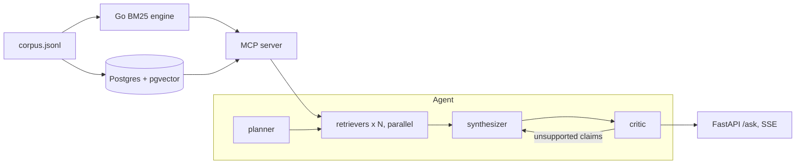

# Research Agent

A LangGraph agent that answers research questions over Wikipedia articles on the history of
computing. It splits the question into sub-queries, retrieves for each in parallel with hybrid
search (a Go BM25 engine plus pgvector, fused with RRF, both exposed through an MCP server), writes
an answer with chunk citations, and a critic checks every claim against its cited chunk, with at
most 2 rewrites. FastAPI streams node progress over SSE; run state is checkpointed in Postgres.



## Stack

Go, Python, LangGraph, FastAPI, PostgreSQL + pgvector, fastembed (`bge-small-en-v1.5`), MCP (FastMCP), Gemini (swappable via `LLM_PROVIDER`).

## Layout

| Path                      |                                                                         |
| ------------------------- | ----------------------------------------------------------------------- |
| `search-engine/`          | Go BM25 engine: `GET /search?q&k&mode`, `/doc/{id}`, `/stats`           |
| `scripts/build_corpus.py` | MediaWiki API to `data/corpus.jsonl` (250-word chunks, 40-word overlap) |
| `scripts/ingest.py`       | embed chunks and upsert into pgvector (HNSW, cosine)                    |
| `rag/retrieval.py`        | bm25, vector, hybrid (40 + 40 candidates, RRF k=60, top 10)             |
| `rag/mcp_server.py`       | `bm25_search`, `vector_search`, `hybrid_search` tools over stdio        |
| `rag/agent.py`            | planner, parallel retrievers (`Send`), synthesizer, critic              |
| `rag/api.py`              | `POST /ask` (SSE), `GET /runs/{id}`, `POST /runs/{id}/resume`           |
| `eval/`                   | retrieval eval, paired statistics, end-to-end groundedness eval         |
| `docs/`                   | from-scratch explanations and interview notes                           |

## Run

```bash
python3 -m venv .venv && .venv/bin/pip install -r requirements.txt
cp .env.example .env                     # set GOOGLE_API_KEY

docker run -d --name rag-pg -e POSTGRES_USER=rag -e POSTGRES_PASSWORD=rag -e POSTGRES_DB=rag -p 5433:5432 pgvector/pgvector:pg16
PYTHONPATH=. .venv/bin/python scripts/ingest.py --reset

(cd search-engine && go run . -dump ../data/corpus.jsonl -max 0)      # terminal 2
.venv/bin/uvicorn rag.api:app --port 8080                              # terminal 3

curl -N -X POST localhost:8080/ask -H 'content-type: application/json' \
     -d '{"question": "How did the Manchester Baby differ from ENIAC?"}'
```

`data/corpus.jsonl` is included; `scripts/build_corpus.py` regenerates it. `docker-compose.yml` is
provided but untested.

Evals: `python -m eval.retrieval_eval`, `python -m eval.paired_stats`, `python -m eval.e2e_eval --n 20`
(run with `PYTHONPATH=.`).

## Benchmarks

Corpus: 1,594 chunks from 108 articles. All questions are LLM-generated.

**Retrieval** (100 paraphrased questions, gold = source chunk)

| mode   | hit@5 | MRR@10 |
| ------ | ----- | ------ |
| bm25   | 0.700 | 0.544  |
| vector | 0.620 | 0.444  |
| hybrid | 0.780 | 0.565  |

Paired bootstrap 95% CI for hybrid minus bm25: hit@5 [-0.01, +0.17], MRR@10 [-0.04, +0.08].

**Go engine** (300 random 4-word queries, k=10, engine-side `took_ms`): bm25 p50 0.125 ms / p95 0.289 ms;
`and` p50 0.032 ms / p95 0.1 ms.

**Groundedness** (LLM judge, 12 questions answered by both agents): hybrid 0.667, bm25-only 0.583.
Runs lost to free-tier quota errors: 5 of 20 hybrid, 4 of 20 bm25.

## Limitations

- Synthetic questions and a same-family LLM judge; sample sizes are small.
- Corpus is smaller than planned because Wikipedia rate-limits full-text fetches.
- The Go index is in-memory and not safe for writes during search (load, `Finalize`, serve).
- The workflow is fixed; the LLM does not choose tools.
